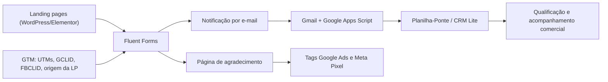

# CRM Lite — Captura, atribuição e automação de leads

Estudo técnico de um **CRM Lite aplicado em uma empresa**, integrando landing pages, formulários, identificação de origem, campanhas de mídia, automação e acompanhamento comercial. Este repositório demonstra o fluxo e as decisões de implementação; **não contém registros reais de leads**.

## Visão geral

## Funcionalidades implementadas

- Formulários para dois perfis comerciais, com exemplo técnico principal na **LP de varejo**.
- Captura de `utm_source`, `utm_medium`, `utm_campaign`, `utm_content`, `utm_term`, `gclid` e `fbclid`, com persistência em cookies por até 90 dias.
- Identificação da landing page de origem e preenchimento de campos ocultos.
- Conversões Google Ads e Meta Pixel na página de agradecimento de cada fluxo.
- Leitura automática de notificações do Gmail por acionador temporal do Google Apps Script.
- Deduplicação, geração de protocolo `LEAD-AAAAMMDD-XXXX`, normalização de dados e escrita no Google Sheets.
- Estrutura de 28 colunas para rastrear origem, atendimento e evolução do lead.

## Tecnologias

**WordPress · Elementor · Fluent Forms · HTML/CSS/JavaScript · Google Tag Manager · Google Ads · Meta Pixel · Google Apps Script · Gmail · Google Sheets · GA4**

## Estrutura do repositório

| Pasta | Conteúdo |
| --- | --- |
| `src/apps-script/` | Automação operacional, parametrizada sem credenciais nem ID real da planilha |
| `src/tracking/` | Scripts de captura de UTMs e identificação de LP, extraídos do GTM |
| `config/gtm/` | Exportações de configuração e evolução do contêiner |
| `config/fluent-forms/` | Definição do formulário de varejo |
| `landing-pages/` | HTML preservado das páginas de captação |
| `dados-ficticios/` | Esquema de 28 colunas e casos demonstrativos inteiramente inventados |
| `docs/` | Arquitetura, testes, limitações e implementação |

## Evidência do fluxo de varejo

No teste observado via GTM Preview/Tag Assistant em **21/11/2026**, depois do envio do formulário e do redirecionamento para a página de agradecimento, dispararam **Lead Varejo** (Google Ads, uma vez) e **Meta Pixel - Lead Varejo** (uma vez). Também foram observados Conversion Linker, Meta Pixel Base, GA4 Base, UTM Capture e LP Origem. Isso demonstra o disparo local das tags; não é confirmação independente de recebimento na interface das plataformas.

A rotina do Apps Script utiliza o assunto da notificação do formulário de varejo para identificar mensagens e registrar o protocolo na planilha. A exportação de GTM inclui também configurações de uma campanha de Live, externas ao escopo principal do CRM Lite.

## Privacidade e reprodução

**Todos os leads publicados são fictícios.** Não há nomes, telefones, e-mails nem documentos de leads reais. Identificadores de acesso ou conexão com serviços reais devem ser configurados em ambiente próprio; o script traz placeholders para valores locais. Os arquivos de HTML exportados pelo navegador podem depender de recursos externos e não equivalem a um backup instalável de WordPress.

Este projeto **não integra Salesforce**. Nenhuma integração futura de CRM externo ou retorno de conversões offline é apresentada como já implementada.

> Repositório de portfólio técnico. A presença de código de referência não concede direitos sobre marcas, bibliotecas ou ativos de terceiros. Respeite os direitos dos respectivos titulares.
