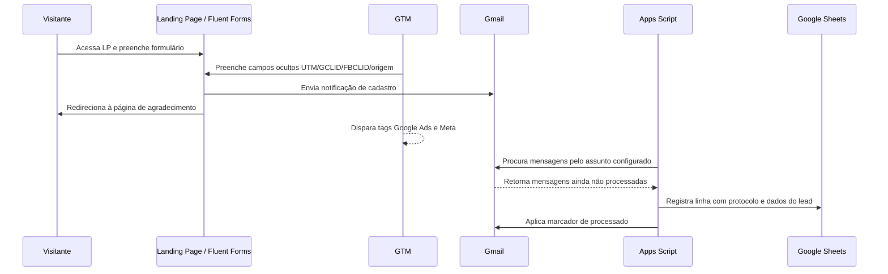

# Arquitetura — CRM Lite

## Objetivo

Centralizar leads comerciais provenientes de landing pages e manter dados de aquisição, protocolo e andamento de atendimento em uma Planilha-Ponte.

## Componentes

1. **Landing pages:** duas variações comerciais, com exemplo documentado de varejo.
2. **Formulário:** Fluent Forms nº 4, com campos visíveis e ocultos para atribuição.
3. **Tracking:** GTM v6 contém Google Ads, Meta Pixel, UTMs, origem da LP e tags de inscrição em Live (fora do escopo do CRM Lite).
4. **Notificação:** e-mail com assunto `Revendedor - Formulario LP`.
5. **Processamento:** Apps Script com `processarLeads`, leitura de Gmail, validação de campos, tratamento de mensagens e deduplicação.
6. **Armazenamento:** Google Sheets, aba `Leads`, com 28 colunas para operação comercial.

## Restrições verificadas

- As conversões do varejo usam pageviews da página `/obrigado-pelo-cadastro-varejo/`.
- A exportação do GTM não inclui uma tag específica de evento GA4 para lead de varejo; as conversões documentadas são Google Ads e Meta.
- O Apps Script de referência busca mensagens de varejo. Não se afirma automação completa do fluxo distribuidor sem comprovação equivalente.
- O identificador de protocolo utiliza um trecho de digest; eventual colisão é possível, embora a rotina faça controle de duplicidade.
- Não há integração com Salesforce neste projeto.
